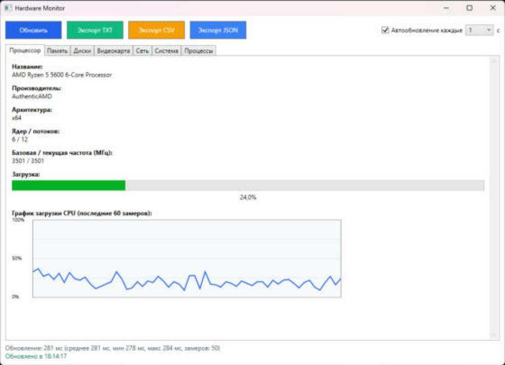
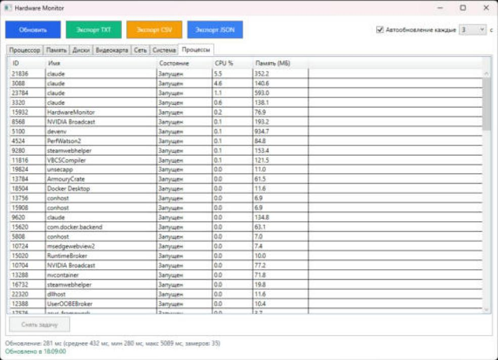
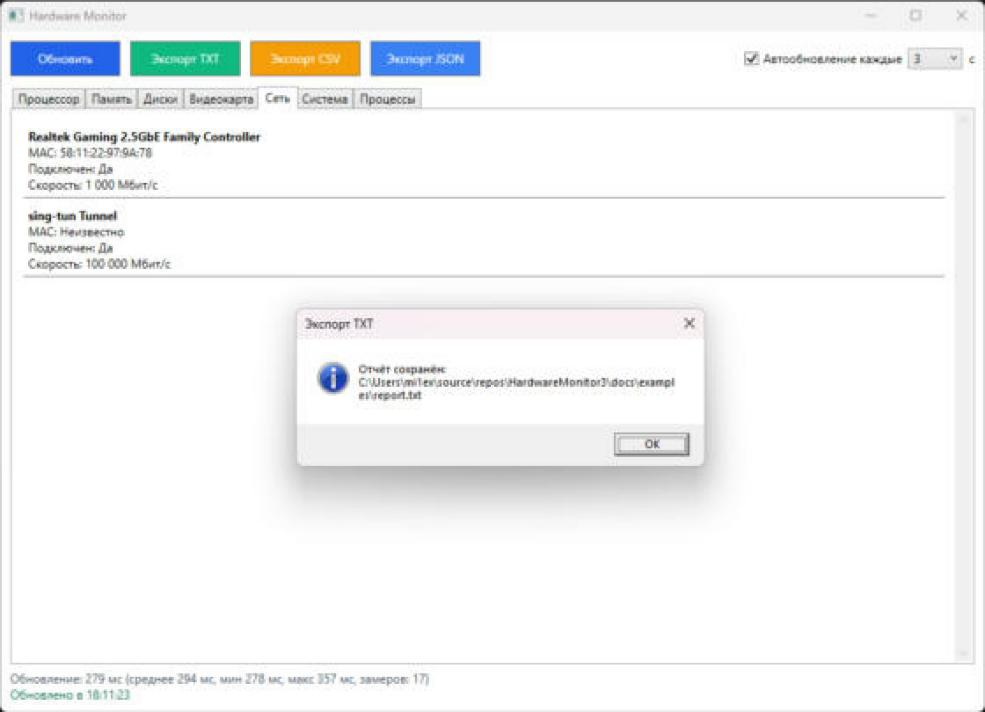

# Hardware Monitor — Лабораторная работа №1

WPF-приложение для мониторинга аппаратного обеспечения компьютера через **WMI** (Windows Management Instrumentation).
Дисциплина «Системное программное обеспечение».



## Что умеет приложение

- **Процессор** — модель, производитель, архитектура, ядра и потоки, частота, текущая загрузка и график загрузки за последние 60 замеров
- **Оперативная память** — общий, используемый и свободный объём, процент использования, модули памяти (производитель, объём, частота)
- **Диски** — физические диски (модель, размер, тип) и логические диски с индикатором заполнения
- **Видеокарта** — название, объём видеопамяти (больше 4 ГБ читается из реестра драйвера), версия драйвера, разрешение, частота обновления
- **Сеть** — сетевые адаптеры: MAC-адрес, подключение, скорость
- **Система** — версия Windows, архитектура, имя компьютера, пользователь
- **Процессы** — список процессов с загрузкой CPU и памятью, завершение выбранного процесса
- **Автообновление** с интервалом 1, 2, 3, 5, 10 или 30 секунд (можно выключить), опрос идёт в фоне — окно не подвисает
- **Статистика опроса** — время последнего обновления, среднее, минимум и максимум
- **Экспорт** отчёта в TXT, CSV (для Excel: разделитель «;», UTF-8 с BOM) и JSON

## Скриншоты

| Процессы | Экспорт |
|----------|---------|
|  |  |

Примеры экспортированных файлов: [docs/examples](docs/examples).

## Как запустить

1. Открыть `HardwareMonitor.slnx` в Visual Studio 2022 или новее
2. Build → Rebuild Solution (NuGet-пакеты восстановятся сами)
3. Запустить (F5) или открыть `HardwareMonitor\bin\Debug\HardwareMonitor.exe`

Требования: Windows 10/11, .NET Framework 4.8 (уже есть в Windows 10/11). Некоторые WMI-классы без прав администратора могут быть недоступны — программа покажет это в строке состояния и продолжит работу.

## Технологии

| Технология | Назначение |
|------------|------------|
| C#, .NET Framework 4.8 | язык и платформа |
| WPF + MVVM | интерфейс, привязки, команды |
| System.Management (WMI, WQL) | получение сведений о железе |
| Task.Run, async/await, DispatcherTimer | фоновое обновление |
| Newtonsoft.Json | экспорт в JSON |

## Используемые WMI-классы

| Класс | Назначение |
|-------|------------|
| Win32_Processor | характеристики процессора |
| Win32_PerfFormattedData_PerfOS_Processor | текущая загрузка CPU |
| Win32_OperatingSystem | объём и свободная память, версия ОС |
| Win32_PhysicalMemory | модули памяти |
| Win32_DiskDrive | физические диски |
| Win32_LogicalDisk | логические диски |
| Win32_VideoController | видеокарта |
| Win32_NetworkAdapter | сетевые адаптеры |

## Структура проекта

```text
HardwareMonitor/
├── Models/        классы данных: CpuInfo, MemoryInfo, DiskInfo, VideoControllerInfo, NetworkAdapterInfo, SystemInfo, ProcessInfoModel
├── Services/      WMI-запросы: CpuMonitor, MemoryMonitor, DiskMonitor, VideoMonitor, NetworkMonitor, SystemInfoService, ProcessMonitor
├── ViewModels/    BaseViewModel (INotifyPropertyChanged), RelayCommand (ICommand), MainViewModel
├── Views/         MainWindow.xaml — интерфейс
└── Converters/    BytesToMBConverter
docs/
├── Отчёт_лаба1.docx   отчёт по лабораторной работе
├── examples/          примеры экспорта TXT, CSV, JSON
└── screenshots/
```

## Отчёт

[docs/Отчёт_лаба1.docx](docs/Отчёт_лаба1.docx)

## Автор

Ростовцев Д. А., группа Б.ИВТ.ПРОМ.23.01
Тверской государственный технический университет, 2026
